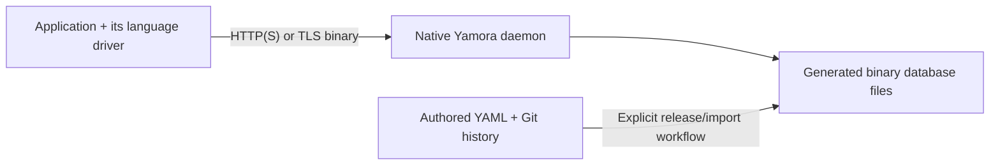

# Drivers and production deployment

A Yamora driver is a library used by an application to call the database API.
It runs in that application's process. The database server runs the native C
daemon and owns its binary storage files.

For example, a Python service uses the Python driver; a PHP application uses
the PHP driver. Neither requires the other application's language runtime.
Installing the database daemon does not install or launch every driver. Keeping
all driver source in the project makes their protocol contracts and tests
reviewable together.

An application and the database may initially share a host. With separate hosts,
the application connects to the configured database API address. A replica set
runs native daemons on its database hosts; applications still use their own
driver. The daemon's peer transport and an application's API transport are
separate connections. See [replica sets](replica-sets.md) and
[TLS configuration](tls.md) for those profiles.

## Choosing a driver

The [Python client](../client.py), [Go](../drivers/go/README.md),
[Java](../drivers/java/README.md), [Node.js](../drivers/node/README.md),
[Ruby](../drivers/ruby/README.md), [Rust](../drivers/rust/README.md),
[C++](../drivers/cpp/README.md), [PHP](../drivers/php/README.md) and
[C#](../drivers/csharp/README.md) drivers include cluster-aware clients.
They discover leaders through configured
trusted seeds and preserve the original request ID and bytes when recovering an
uncertain write. These clients have focused Linux tests against the native
daemon. Each driver's documentation records supported calls,
runtime requirements and verification:

| Application language | Driver documentation |
| --- | --- |
| Java | [Java](../drivers/java/README.md) |
| JavaScript / TypeScript | [Node.js](../drivers/node/README.md) |
| Ruby | [Ruby](../drivers/ruby/README.md) |
| Rust | [Rust](../drivers/rust/README.md) |
| C++ | [C++](../drivers/cpp/README.md) |
| PHP | [PHP](../drivers/php/README.md) |
| C# / .NET | [C#](../drivers/csharp/README.md) |

A standalone client does not automatically gain leader discovery or safe retries
for uncertain cluster writes.

All nine drivers provide separate TLS binary document clients for GET, HEAD,
PUT and DELETE, plus negotiated schema-2 query, aggregate, search, PATCH,
transaction and bounded change-feed operations. They use owned trust material,
bounded calls and typed write uncertainty without automatic replay. Operation
results preserve exact response bytes; feed callbacks expose only complete
validated pages and their raw bytes. Native document values retain their depth
limit of 64; operation response readers allow bounded nesting up to 80 so wrappers
can carry values admitted at that limit. Their HTTP cluster
clients retain discovery and recovery support. See the
[binary listener](binary-runtime.md) and [Python binary client](python-binary.md).
Binary calls use the supplied endpoint and do not infer cluster discovery or
safe replay. The [shared conformance contracts](../conformance/README.md)
separately cover binary documents, HTTP replica receipts and binary operations.

The [local Linux x86_64/glibc distributions](../../docs/site_history/changelog/entries/2026-10/20261026T144752068323-0500-qualify-all-nine-installed-operation-sdks-and-depth-acceptan.md)
have passed all three profiles, separate native-depth acceptance and all ten
shipped public examples through isolated installed consumers.

Use the [wire protocol](../PROTOCOL.md) as the API contract. Drivers preserve raw
YAML source bytes and expose revision/ETag preconditions. Binary operations
return raw JSON within each driver's documented validation bounds. For HTTP
decoded results, use the driver's documented numeric representation and token
limits; raw response preservation does not promise an unlimited numeric domain.
Do not silently round database integers into a language's floating-point type.
Each application supplies its own endpoint, credentials and trusted TLS
configuration. Credentials belong in the application's secret store.

The [enterprise roadmap](../../docs/plans/yamora-enterprise-roadmap.md) tracks
installed-package and platform qualification separately from source foundation
tests. Local distributions require isolated installed consumers and native
example postconditions. Development source is not evidence of a registry
publication or support on an untested platform. The owner subsequently authorized
[native Windows SDK checks on .129](windows-sdk-qualification.md): Java and Node
pass the targeted binary checks, and Go/Ruby/PHP pass public HTTPS examples.
Python, C#, package installation and the broader Windows profiles retain the
documented blockers and gaps. Native macOS checks remain owner-excluded and
unverified; Linux results do not qualify other platforms.

For development and CI, the [shared SDK runner](../../tools/ci/yamora_driver_ci/README.md)
executes the native-daemon suites with private toolchains and caches. Those
build tools belong to verification jobs, separate from production database hosts.

## Source history and production files

Keep authored YAML and Git history in the source workflow. Production serves
generated native binary files while retaining exact document source for API
reads and exports. Drivers do not replace Git or automatically commit API writes
to a repository. [Bidirectional Git synchronization](gitops.md) uses an explicit
coordinator with guarded publication and recovery. [Branches and retained
commit queries](native-branches.md) use the native history capability and its
bounded retention contract.

The surrounding Classic Chess deployment currently uses a loopback, read-only
Yamora service behind its Python application. Public website clients call the
website's REST API. Adding another language driver does not change that service
boundary or launch another production process.
